# Retirement Optimizer User Guide

Retirement Optimizer helps you explore how Roth conversions and Social Security
claim ages could affect retirement spending, taxes and the estate you leave
behind. You enter your household information and assumptions; the app compares
modeled strategies and explains their results.

Use it to prepare questions, compare choices and support a discussion with a
qualified professional.

> **Important: educational software, not professional advice**
>
> Retirement Optimizer is an open-source application released under the MIT
> License. It is provided "as is," without warranty, as described in the
> [LICENSE](../LICENSE). The software may contain errors, and its calculations
> rely on assumptions and simplified rules. Projections and simulated outcomes
> are not guarantees.
>
> The app's recommendations, reports, sale suggestions and optional AI
> summaries are not personalized financial, investment, tax or legal advice.
> Before making Social Security claiming decisions, Roth conversions,
> withdrawals or investment sales, consult a qualified CFP® professional and/or
> CPA, as appropriate to the decision. Have them review your actual
> circumstances, current rules and the app's assumptions.
>
> The app does not file benefit applications, execute trades or move money.

> **Your data stays on your computer**
>
> Everything you enter — plan names, birth dates, balances, income, Social Security
> amounts, holdings — and every result is stored and calculated **only on your
> own computer**. The app has no account, no cloud service, no analytics or
> tracking, and does not fetch market prices or anything else from the
> internet. Started as the [Installation Guide](INSTALL.md) describes, it
> accepts connections only from your own computer. Your personal
> information is not transmitted to any website, app or cloud service.
>
> The one exception is opt-in: if you configure a **cloud** AI provider for the
> optional AI summary and click **Generate AI summary**, a limited set of
> figures from that run is sent to that provider — never plan names, birth dates,
> your state or holdings. A local AI model keeps even that on your computer.
> See [Data, privacy and optional AI summaries](#8-data-privacy-and-optional-ai-summaries).

## Contents

- [Key features](#key-features)
- [1. Before you begin](#1-before-you-begin)
- [2. Create your first plan](#2-create-your-first-plan)
- [3. Run, reopen and recover a plan](#3-run-reopen-and-recover-a-plan)
- [4. Understand your results](#4-understand-your-results)
- [5. Explore a different choice](#5-explore-a-different-choice)
- [6. Use your portfolio](#6-use-your-portfolio)
- [7. Save and discuss your results](#7-save-and-discuss-your-results)
- [8. Data, privacy and optional AI summaries](#8-data-privacy-and-optional-ai-summaries)
- [9. Assumptions and limits](#9-assumptions-and-limits)
- [10. Common questions](#10-common-questions)
- [For technical readers](#for-technical-readers)

---

## Key features

| Feature | What it gives you |
|---|---|
| **Roth-conversion strategy comparison** | Every candidate strategy — no conversions, filling a tax bracket each year, or converting a fixed dollar amount each year, each with different stopping years — is simulated year by year over your whole plan with federal and state income tax, Medicare surcharges (IRMAA), required minimum distributions (RMDs) and Social Security taxation. |
| **Social Security claim-age search** | For each person not yet receiving benefits, the app can try every eligible claim age from 62 to 70 and choose the ages together with the conversion strategy, because later claiming leaves more low-income years for conversions. |
| **Market simulation (Monte Carlo)** | Returns vary from year to year across simulated market scenarios. The app screens strategies in stages, then evaluates the finalists and comparison baselines on 300 shared market scenarios, so comparisons between them are fair. The exports show how many scenarios each strategy received. |
| **Plain-language comparisons** | Results say how the recommendation compares with your own choices and with its closest alternatives, and say so when the simulation cannot tell two strategies apart. |
| **Lifespan checks** | A claim-age search re-scores the leading strategies with the plan ending five years earlier or later and, for a couple, with either spouse dying at 78. |
| **Year-by-year explanations** | Each year of the plan states what it does and why: which bracket a conversion filled, which thresholds were near, and why a year makes no conversion. |
| **What-if page** | Change one input — spending, claim ages, a death age, a strategy, a constraint — and see its effect side by side with your plan, on the same market scenarios. |
| **Portfolio and sale planner** | Upload your holdings once. On a plan's results, turn the first year's taxable withdrawal into a suggested sell list, ordered to limit taxable gains. |
| **Excel Tax Audit sheet** | The Excel export shows, year by year and line by line, how each year's tax was derived — income stack, deductions, taxable income, federal tax, state tax, Medicare surcharge — so you or a CPA can check it against the IRS worksheets. |
| **PDF, Excel and CSV exports** | Every run is saved as all three formats automatically; download them again at any time. |
| **Optional AI summary** | A plain-English commentary on a run, written by an AI model you configure. A local model keeps everything on your computer. |
| **Readable tax data** | Every tax bracket, deduction and Medicare threshold sits in a plain data file citing its IRS or CMS source, and can be updated each year. |
| **Runs on your computer** | Plans, results and holdings are stored in a local database file. Nothing is sent anywhere unless you configure a cloud AI provider. |

---

## 1. Before you begin

### What the app does

You describe your household once: ages, accounts, income, Social Security,
spending and a few assumptions. The app then:

- builds its Roth-conversion strategies from your accounts and settings: no
  conversions, filling one of five tax brackets every year, converting one of
  three fixed amounts every year, and each of those rules stopped after any
  given year — typically 40 to 110 strategies;
- simulates every one from this year to the end of your plan on a
  steady-return projection, then on the first 100 of 300 market scenarios;
- carries the three leaders, plus *no conversions*, to all 300 scenarios;
- if you ask, repeats this for each eligible Social Security claim age; and
- recommends the strategy (and claim ages) with the highest **modeled score**,
  and shows how close the alternatives are.

[How a recommendation is chosen](HOW_A_RECOMMENDATION_IS_CHOSEN.md) follows
four example households through these steps with the numbers the app
produces for them.

It is an annual planning aid. The first year's figures are the most useful;
later years depend increasingly on assumptions. Re-run your plan each year with
current balances and tax data.

### What it does not do

- It does not choose your spending, your investments or your asset allocation.
  Spending is your input; every account earns the same assumed return.
- It does not model charitable giving, qualified charitable distributions,
  tax-loss harvesting or the Social Security earnings test (see
  [Assumptions and limits](#9-assumptions-and-limits)).
- It does not file applications, execute trades or move money.

### Information to collect

| You will need | Where to find it |
|---|---|
| Birth dates for you (and your spouse, if filing jointly) | — |
| State of residence | — |
| Each account's current balance and type (taxable brokerage, traditional IRA/401(k), Roth IRA/401(k)) and whose it is | Latest statements |
| Total cost basis of each taxable account | Your brokerage's positions or cost-basis page ("Cost Basis" or "Adjusted Cost Basis") |
| After-tax basis in traditional IRAs, if you made non-deductible contributions | Line 14 of your most recent IRS Form 8606 |
| The year you first opened a Roth account | Your Roth custodian's records |
| Other income: salary, pension, rental, interest, qualified and non-qualified dividends, with start and end years | Pay stubs, pension statements, last year's 1099s |
| Capital gains and losses already realized this year, short-term and long-term (net), and any capital loss carried over from last year | Your brokerage's realized gain/loss page for this year; last year's Schedule D and its Capital Loss Carryover Worksheet |
| Each person's Social Security benefit at full retirement age (the *primary insurance amount*, monthly), or the age benefits started if already receiving | [ssa.gov/myaccount](https://www.ssa.gov/myaccount/) → your Social Security Statement → "At your full retirement age" |
| Your household's annual spending, in today's dollars, excluding income taxes | Your budget or last year's spending |
| Optional: your holdings (symbol, shares, price, total cost basis) | Your brokerage's positions download |

### Installing and starting the app

Follow the [Installation Guide](INSTALL.md). Once it is running, open the
address it prints (normally <http://localhost:3000>). Day-to-day commands —
restarting, using another port, resetting the database — are in the
[CLI cheat sheet](CLI_CHEATSHEET.md).

### When the app is updated

Saved results do not recalculate when the app or its tax data is updated. A
run keeps the figures it was made with; re-run the plan to see the effect of an
update.

---

## 2. Create your first plan

The screenshots in this guide show a fictional example couple: both born in
1964, married filing jointly in California, with $2,500,000 in traditional IRAs,
$400,000 in a taxable account, a $50,000 Roth, a $30,000 pension and $90,000 of
yearly spending. Your screens show your own figures.

Click **New Plan** on the dashboard. The wizard has six steps, shown across the
top: **Household**, **Assumptions**, **Accounts**, **Income**, **Spending** and
**Review**. Each field has a **?** you can hover or focus for a short
explanation, and a summary of what you have entered stays beside the form.
Values that cannot be right — a negative balance, income that ends before it
starts, a Roth opened in the future — are refused with a message, and **Next**
lists what to fix.

### Start fresh or copy a plan

If you already have plans, the wizard first offers **Start fresh** or **Copy
this plan's inputs** from one of your ten most recent plans. A copy is a new,
independent plan named *Copy of …*; the original and its results are never
changed. Rename it on the first step.

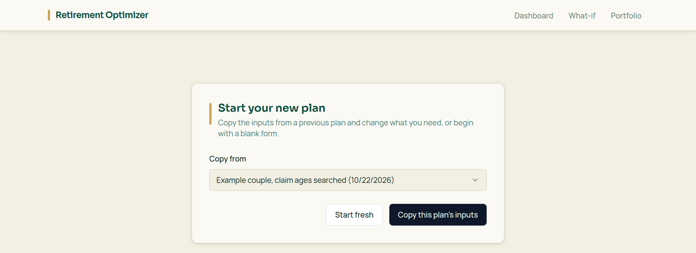
*The first screen when you already have plans: copy one, or start fresh.*

Your progress is kept in this browser as you go. If you leave and come back
within 24 hours, a banner says *Resuming your saved draft* with **Continue** and
**Start over**. An unfinished draft older than 24 hours is discarded; a plan
you have saved is not affected.

### Step 1 — Household Profile

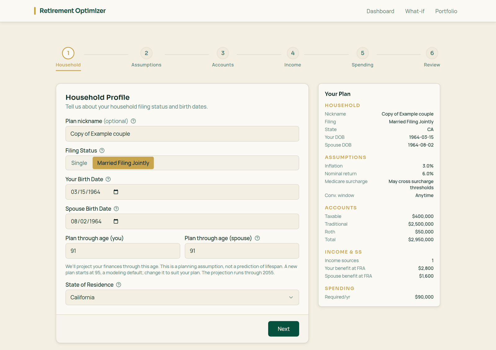
*Step 1 for the example couple, planned through age 91: a 30-year projection. The summary on the right follows you through every step.*

| Field | Notes |
|---|---|
| **Plan nickname** | Shown on your dashboard. |
| **Filing status** | Single or Married Filing Jointly. Sets the tax brackets, standard deduction and Medicare surcharge thresholds. |
| **Your birth date / Spouse birth date** | Ages are the age reached during each tax year. The birth year sets the RMD start age: 73 if born 1951–1959, 75 if born 1960 or later. |
| **Plan through age** | Required for each person; a new plan starts at **95**. The projection runs through the year the later of the two of you reaches this age (at least 10 years), and the Review step shows that end year. It sets only when the projection ends: different ages for the two of you do not schedule a death or a survivor period. This is a modeling assumption, not a prediction of lifespan or a recommendation. A longer horizon tests whether the money lasts longer. |
| **State of residence** | Sets state income tax. See [Assumptions and limits](#9-assumptions-and-limits) for what the state calculation simplifies. |

### Step 2 — Planning Assumptions

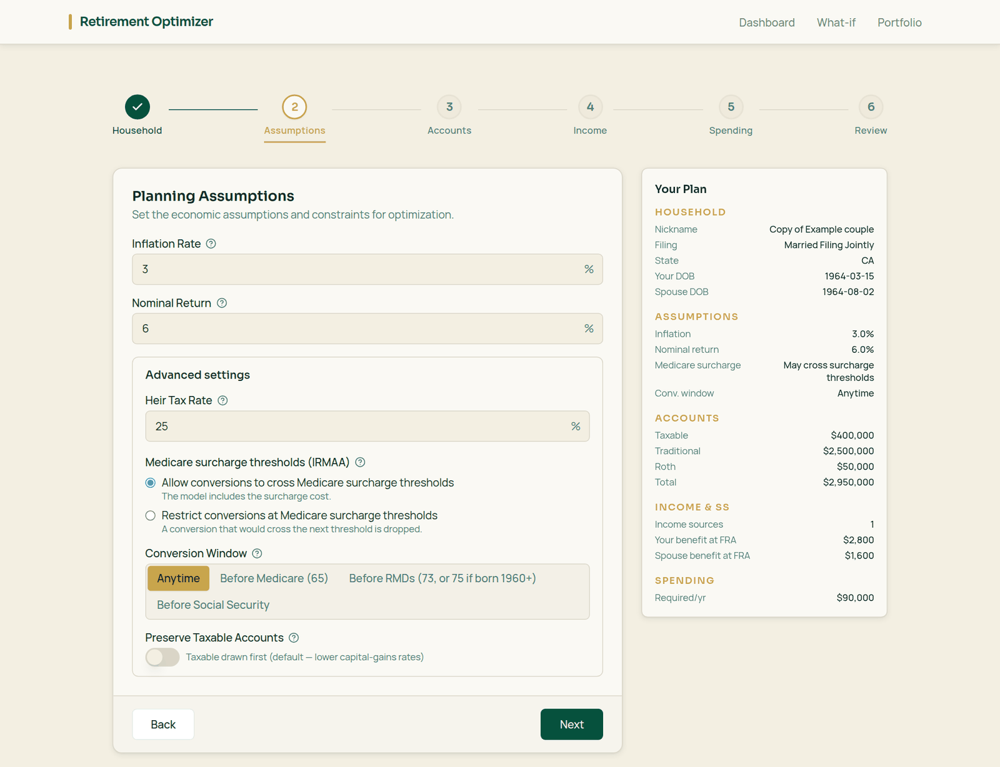
*Step 2. Inflation, return and the advanced settings are all on this page.*

| Field | Notes |
|---|---|
| **Inflation rate** | How fast your spending grows each year (3% to start). It also projects tax brackets past the latest published year and, unless you set a COLA, Social Security increases. |
| **Nominal return** | The average annual investment return before inflation (6% to start), applied to every account. The market simulation varies returns around this average. |

**Advanced settings** sit on the same page. Most plans can keep the starting
values; they are shown so you can see them, not because you must change them.

| Setting | Starting value | What it does |
|---|---|---|
| **Heir tax rate** | 25% | The income-tax rate your heirs would pay on inherited traditional-IRA money. In the estate, each traditional dollar counts as (1 − this rate); Roth and taxable dollars count in full. |
| **Medicare surcharge thresholds (IRMAA)** | Allow | Medicare Part B and D premiums rise in steps once income, measured two years earlier, crosses set thresholds. Each step is a cliff: $1 over adds that tier's whole surcharge for the year, for each person on Medicare. **Allow conversions to cross Medicare surcharge thresholds** counts the surcharge as a cost and lets a conversion cross a threshold when it is worth it. **Restrict conversions at Medicare surcharge thresholds** drops a conversion that would cross the next threshold. Either way, surcharges your income reaches are always charged. |
| **Conversion window** | Anytime | Limits conversions to a period: **Before Medicare (65)**, **Before RMDs** (73, or 75 if born 1960 or later) or **Before Social Security**. Applies to every strategy. |
| **Preserve Taxable Accounts** | Off | Withdrawal order. Off: spend the taxable account first, then traditional, then Roth. On: spend traditional first, then taxable, then Roth — for example to leave taxable assets that heirs receive with a stepped-up basis. Roth is always drawn last. |

### Step 3 — Accounts

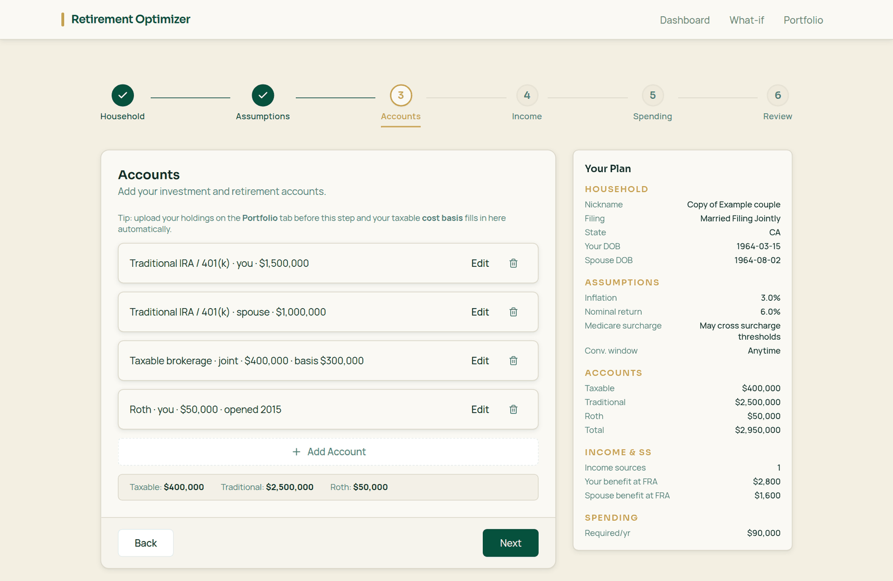
*Step 3. One row per account, with its owner, balance and cost basis.*

Add one entry per account. A finished entry collapses to one line — *Roth · you
· $500,000 · opened 2020* — with **Edit** and **Remove**.

| Field | Notes |
|---|---|
| **Account type** | Taxable brokerage, Traditional IRA / 401(k), or Roth IRA / 401(k). |
| **Owner** | You, your spouse or joint. For a traditional account it decides whose RMD it pays: each person's RMD is figured on their own balance at their own age. An IRA cannot be joint, so a joint traditional account is treated as yours. |
| **Balance** | Today's value. |
| **Cost basis** (taxable) | The total you paid for the investments. The tax projection uses it to size capital gains; leaving it at 0 treats every sale as all gain and overstates tax. It may be above the balance (an account at a loss). If you uploaded a portfolio first and have one taxable account, it is filled in for you; check it. |
| **After-tax basis (Form 8606)** (traditional) | Non-deductible contributions, from line 14 of your latest Form 8606. Blank treats every withdrawal as fully taxable. |
| **Year Roth opened** (Roth) | Required when the balance is above $0. The five-year rule counts from it; the results warn when a planned Roth withdrawal falls within five years of it. |

### Step 4 — Income & Social Security

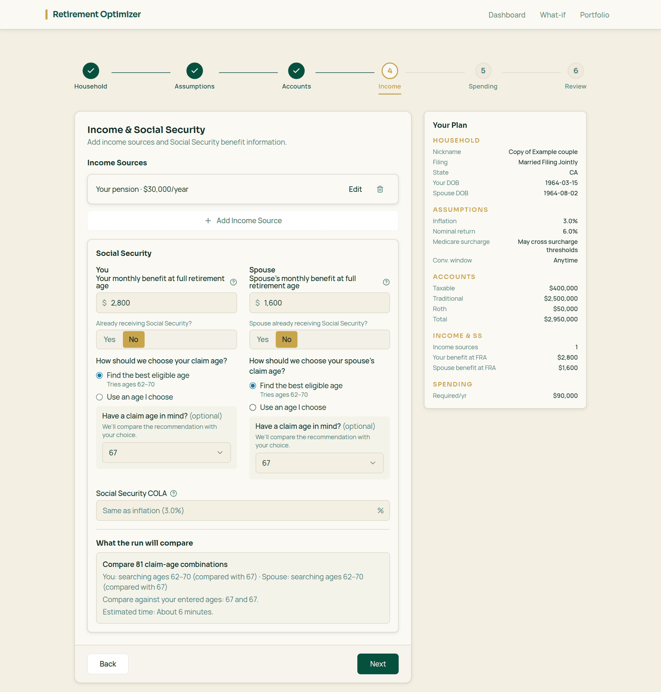
*Step 4 with both claim ages searched and 67 entered for comparison. “What the run will compare” updates as you choose.*

**Income sources.** Add salary, pension, rental income, interest, qualified
dividends and non-qualified dividends, each with an annual amount, an owner and
optional start and end years. A salary or pension owned by one person stops if
that person dies in a death scenario; enter a pension with a survivor benefit as
*joint*.

**Investment gains already realized this year.** Enter the net gain (or, with
**Loss**, the net loss) from investments you have already sold this year,
short-term (held one year or less) and long-term (held longer) separately —
not the total sale proceeds, and not gains on investments you still own. Mutual
fund capital gain distributions count as long-term. Add any short-term and
long-term capital loss carried over from last year's return. These change this
year's tax only; the money from those sales is already in the balances you
entered, so it is not counted again. The app nets them the way Schedule D does
— together with the gains the plan's own sales realize this year — taxes a net
short-term gain as ordinary income and a net long-term gain at capital-gains
rates, deducts up to $3,000 of a net loss from other income, and carries the
rest into later years. A short-term gain uses up bracket room a conversion
would otherwise fill, so the year's recommended conversion is smaller; a
long-term gain does not, but it can make a conversion cost more by pushing
gains into the 15% rate or into the 3.8% net investment income tax. The figures
belong to one tax year: the section shows that year, and a plan run in a later
year ignores them and says so. In a plan or draft from an earlier year, choose
**Start <this year> entries** to replace them.

**Social Security**, for each person:

1. **Your monthly benefit at full retirement age** — the primary insurance
   amount from your Social Security Statement. Use the full-retirement-age
   figure, not the early or delayed ones; the app adjusts it for the claim
   age. Enter 0 for someone with no work record of their own; a spousal
   benefit can still apply.
2. **Already receiving Social Security?** (asked from age 62) — **Yes** asks
   *At what age did benefits start?*, and that age is fixed. Answer it either
   way; the app does not assume.
3. **How should we choose your claim age?** (when not yet receiving):
   - **Find the best eligible age** — the app tries every eligible age and
     recommends one with the conversion strategy. Beneath it, **Have a claim age
     in mind? (optional)** takes an age to compare the recommendation with. If
     you leave it at **No comparison**, no personal claim-age baseline is
     invented: the results compare conversions at the recommended ages only.
   - **Use an age I choose** — an age selector appears; that age is used as
     entered.

   Switching between the two keeps any age you entered. Someone over 70 who has
   not yet filed is not asked; they are modeled as filing this year at the
   age-70 benefit.

**Which ages are eligible.** Every whole age from 62 (or the current age, if
later) to 70, except:

- ages that overlap salary income before full retirement age. The app does not
  calculate Social Security's earnings test, so the search skips these ages.
  This is a modeling restriction; it does not necessarily mean you cannot
  receive benefits at those ages. The reason is stated beside the choice.

**Social Security COLA** (optional) sets how fast benefits grow each year.
Blank uses your inflation rate; 0 holds benefits flat.

A box, **What the run will compare**, summarizes the setup — for example
*Compare 64 claim-age combinations · About 4 minutes*, with each person's ages.

### Step 5 — Spending and goals

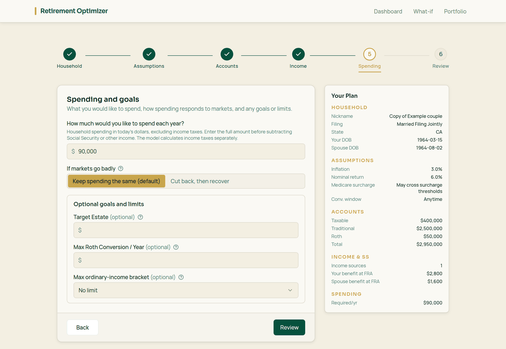
*Step 5 with the default, “Keep spending the same”.*

| Field | Notes |
|---|---|
| **How much would you like to spend each year?** | Household spending in today's dollars, excluding income taxes. Enter the full amount **before** subtracting Social Security or other income. The app works out each year's income taxes and Medicare surcharges and withdraws enough to pay them on top of your spending. |
| **If markets go badly** | **Keep spending the same** (the starting choice) spends your amount, raised for inflation, every year whatever markets do — the strict test of whether the plan lasts. **Cut back, then recover** cuts spending about 10% when your withdrawal rate drifts 20% above where it started, and restores it when markets recover, never above your target. |
| **Minimum annual spending** | Shown for *Cut back, then recover*. Planned cuts never go below it. Left blank, there is no minimum: cuts can continue while markets stay poor. |

**How cuts count.** A cut is a real loss, not free safety. In the modeled score,
spending given up above your minimum counts at half weight; spending the plan
cannot fund below it (or at all, with no minimum) counts in full.

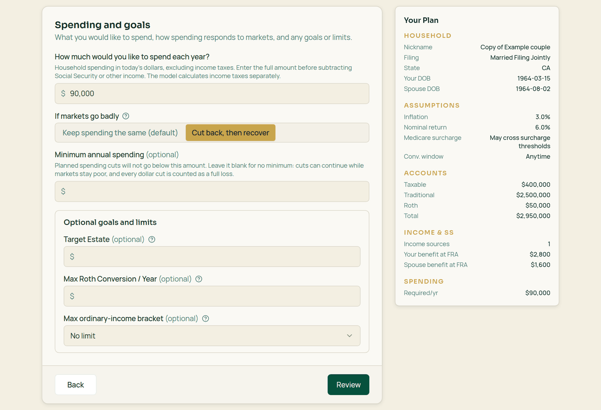
*Choosing “Cut back, then recover” adds the Minimum annual spending field.*

**Optional goals and limits** are also on this page:

| Setting | Notes |
|---|---|
| **Target estate** | A bequest goal, in the dollars of the plan's **final year**. It does not change which strategy is recommended. It changes what counts as success: a market scenario counts toward *Spending funded* only if it funds spending every year **and** ends with at least this after-tax estate. |
| **Max Roth conversion / year** | A dollar cap on any single year's conversion, for every strategy. |
| **Max ordinary-income bracket** | No conversion may push ordinary income past the top of this bracket in any year. It limits the bracket, not the true cost of a converted dollar, which can be higher once more Social Security becomes taxable or a surcharge applies. A low cap can rule out every conversion, for example while a salary already fills that bracket. |

### Step 6 — Review and run

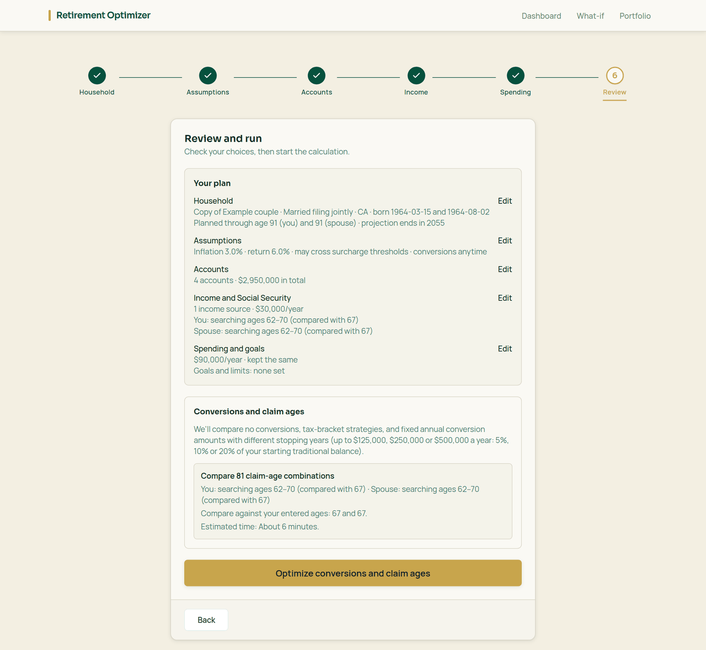
*Step 6. Each step has an Edit link, and the button is named for what it runs.*

Review asks nothing new. It summarizes each step, with an **Edit** link back to
it, shows the year the projection ends, and flags any step left incomplete. It
then states what will be compared: *no conversions, tax-bracket strategies, and
fixed annual conversion amounts with different stopping years*, with those
amounts in dollars. The fixed amounts are 5%, 10% and 20% of your starting
traditional balance; a custom amount and duration (say, $75,000 a year for four
years) is not offered. [How a recommendation is chosen](HOW_A_RECOMMENDATION_IS_CHOSEN.md)
walks four example households through what happens next.

The button is named for what it runs:

- **Optimize conversions** — every claim age is fixed.
- **Optimize conversions and claim ages** — at least one is searched.

---

## 3. Run, reopen and recover a plan

### Running

Clicking the Review button saves the plan and starts the run.

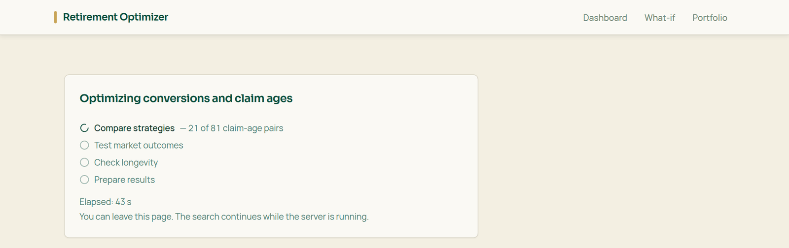
*A claim-age search in progress. You can leave this page.*

- **Optimize conversions** usually finishes in under a minute and opens the
  results.
- **Optimize conversions and claim ages** takes a few minutes, so it runs in the
  background. A progress page shows four stages — **Compare strategies**,
  **Test market outcomes**, **Check longevity**, **Prepare results** — and opens
  the results when done. You can leave it: the header shows *Search running ·
  View progress* on every page.

Only one claim-age search runs at a time. If another is running, Review says so,
links to its progress, and does not start yours.

**Stopping the app interrupts a search.** Searches are held in the server's
memory. If you stop the app mid-search, nothing from that search is saved; the
progress page says so and offers **Run again**.

### The dashboard

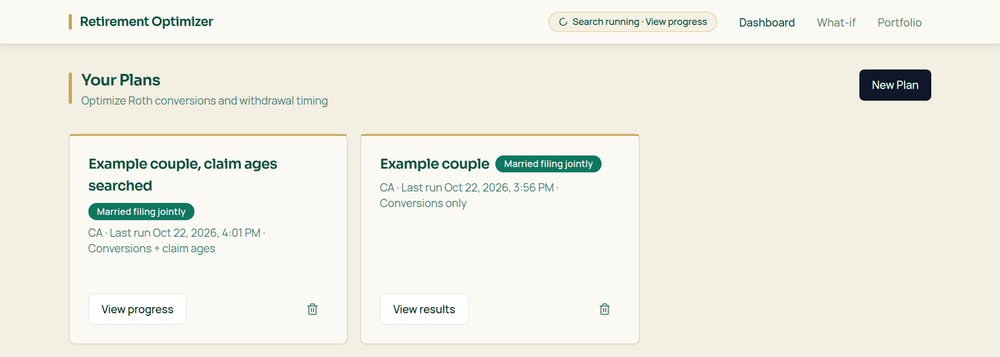
*The dashboard while a search runs: “View progress” on that plan, and “Search running · View progress” in the header.*

Each plan's card shows its name, latest run and one action:

| Action | When |
|---|---|
| **View results** | The plan has a completed run. Opens the latest. |
| **View progress** | A search for the plan is running. |
| **Finish setup and run** | The plan was saved but no run completed — for example, another search was running. It opens Review for **the same plan** (not a copy); running it updates that plan. Your claim-age choices are kept. If this browser has no record of them, Review asks you to confirm each person's choice before running, rather than guess. |

The trash icon, **Delete plan**, asks for confirmation and then removes the plan
and all its runs from the database.

### Changing a plan after it has run

A plan with results is a record of what you ran. To try a change:

- use the **[What-if page](#5-explore-a-different-choice)** for a quick,
  unsaved comparison; or
- start a **New Plan**, choose **Copy this plan's inputs**, change what you
  want and run it, for a separate plan with its own saved results.

---

## 4. Understand your results

### Four ideas to know first

**Modeled score.** The average after-tax estate across the simulated market
scenarios, minus weighted penalties for spending the plan could not fund,
expressed in today's dollars. *After-tax* means traditional-IRA money counts
after your heir tax rate. The recommendation is the strategy with the highest
modeled score. It is a ranking measure: not an account balance, not tax saved
and not a guaranteed benefit.

**Steady-return projected estate.** The modeled estate at the end of the plan
if investments earned exactly your assumed return every year. Its
*Equivalent to … today* figure is the same amount discounted to today — not
another projection, and not the simulation's average.

> **About "today's dollars".** Figures labeled *today's dollars* or *present
> value* are discounted at a fixed **2% a year**, not at your inflation rate.
> With 3% inflation, they are somewhat higher than an inflation-adjusted value
> would be. Every strategy uses the same discount rate. The rate affects how
> future amounts are valued and can affect comparisons between strategies:
> the estate arrives at the end of the plan, while spending shortfalls can
> occur throughout it.

**Spending funded.** The share of market scenarios in which the plan funded
spending in every year. With *Cut back, then recover*, a scenario counts as
funded if it paid the reduced spending the rule allowed — so read it beside the
number of years spending fell below your target. With a target estate, a
scenario must also end with at least that estate.

**Comparison.** Every comparison names both strategies — *Your ages 65 / 63 →
Recommended ages 69 / 68*, *No conversions → Recommendation* — and measures
them the same way, on the same market scenarios. The difference is between
those two named strategies only.

> **Illustration (invented figures, not from any real plan).** Suppose a
> strategy's steady-return projection ends 25 years from now with an after-tax
> estate of **$3,000,000**. Discounted at 2% a year, that is equivalent to
> about **$1,828,593** today.
>
> In the market simulation, returns vary. Withdrawals happen every year, and
> losses early in retirement force larger sales from a smaller portfolio, so
> the average outcome is usually not the steady-return outcome. Say the 300
> scenarios average **$1,790,000** of after-tax estate in today's dollars, and
> some scenarios run short of spending, costing an average **$15,000** in
> penalties. The modeled score is **$1,775,000**.
>
> The $1,828,593 and the $1,775,000 differ because they measure different
> things — one return path versus many, and the score subtracts shortfalls.
> Neither is a forecast, and the difference is not a gain or loss.

The page reads from top to bottom in this order.

### The recommendation

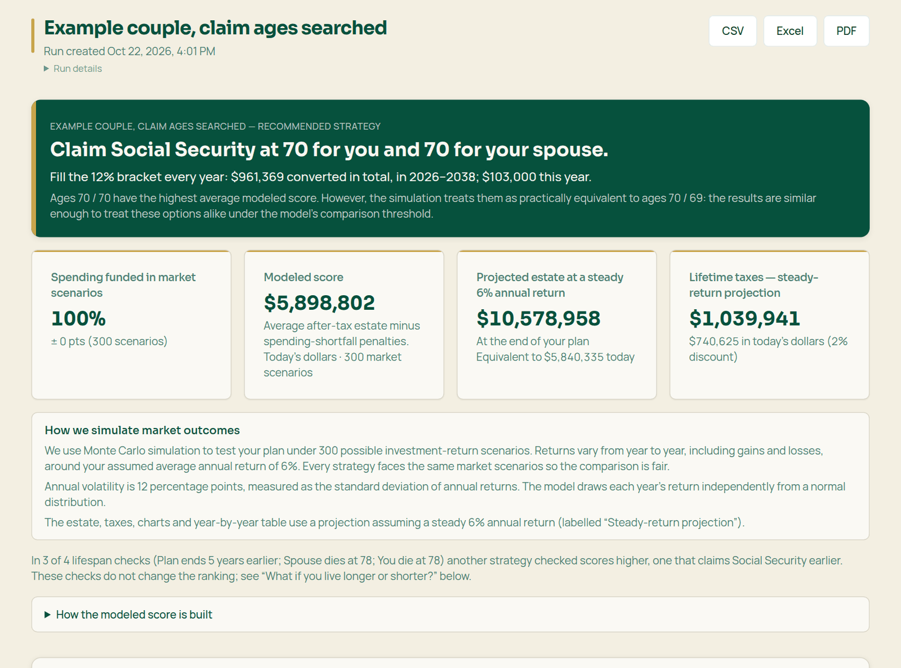
*The top of the results page for the example couple with both claim ages searched.*

A banner states the decision:

- the claim ages, for a search: *Claim Social Security at 70 (you) and 67
  (spouse)* (a fixed-age run states the ages it used);
- the conversions: the strategy, the total converted, the years conversions
  happen and this year's amount — or that the plan makes no conversions; and
- how clearly it leads its closest alternatives.

The recommendation is the highest-ranked strategy among those evaluated, under
your inputs and the model's assumptions. It is not proof of a unique best
real-world decision. For how the strategies are built, screened and ranked,
with worked examples, see [How a recommendation is chosen](HOW_A_RECOMMENDATION_IS_CHOSEN.md).

**Run details** under the plan name lists the Run ID and Plan ID, useful for
matching a result to its exported files.

### Summary cards

| Card | What it shows |
|---|---|
| **Spending funded in market scenarios** | The share of scenarios that funded spending every year, with a margin — *96% · ± 2 pts (300 scenarios)*. Read it as a range. A note gives the average number of years spending fell below target, if any. |
| **Modeled score** | *Average after-tax estate minus spending-shortfall penalties*, in today's dollars, with the scenario count. |
| **Projected estate at a steady N% annual return** | The steady-return estate at the end of the plan (in that year's dollars), with *Equivalent to … today* beneath it. N is your assumed return. |
| **Lifetime taxes — steady-return projection** | Federal and state income tax plus Medicare surcharges over the whole plan, with the present value beneath it. |

Beneath the cards, **How we simulate market outcomes** states the run's
assumptions: the number of scenarios, the average return and the volatility.
Advisories follow — for example, when another strategy funds spending in more
scenarios, or a planned Roth withdrawal falls inside the five-year rule.
**How the modeled score is built** shows the score's parts.

### Recommended strategy compared with your original choices

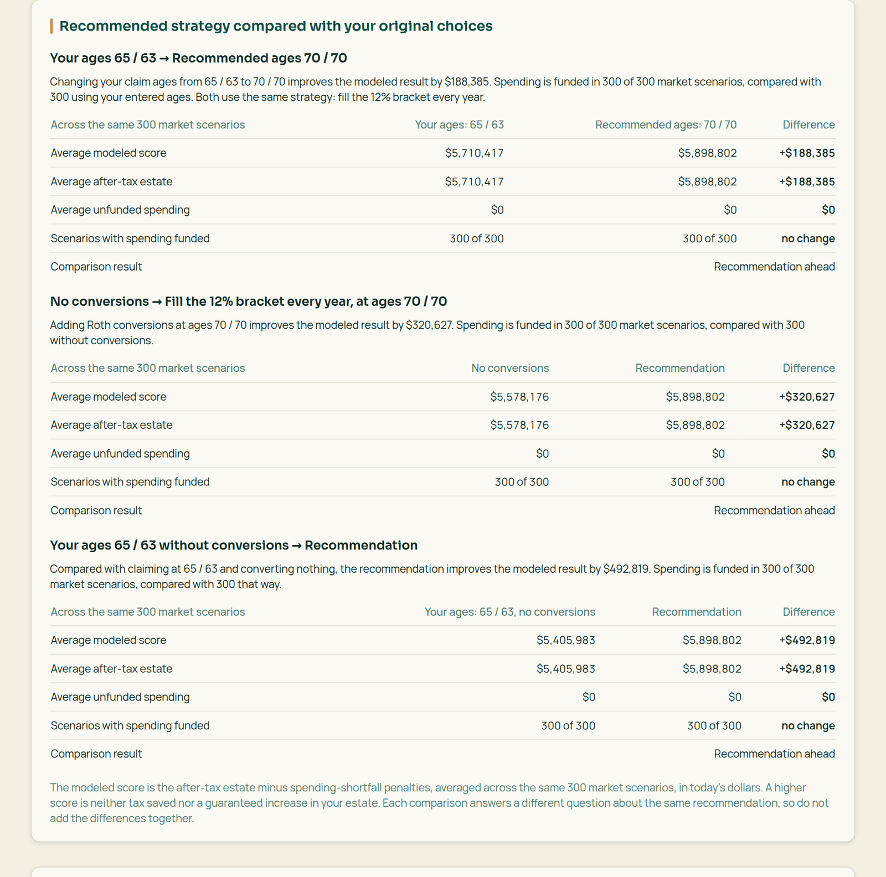
*Each comparison answers a different question about the same recommendation.*

Up to three *from → to* comparisons, each with a sentence and a table showing
both outcomes and the difference:

| Comparison | Compares the recommendation with |
|---|---|
| **Your ages → Recommended ages** | Your comparison claim ages, with their best conversion strategy |
| **No conversions → the recommended strategy** | The recommended claim ages with no conversions |
| **Your ages without conversions → Recommendation** | Your comparison ages with no conversions |

The comparisons overlap, so do not add their differences together. A fixed-age
run has only the conversion comparison. If there is nothing to compare — no
comparison ages and a recommendation with no conversions — the section is
replaced by one line: *No comparison claim ages were provided.*

### Close alternatives

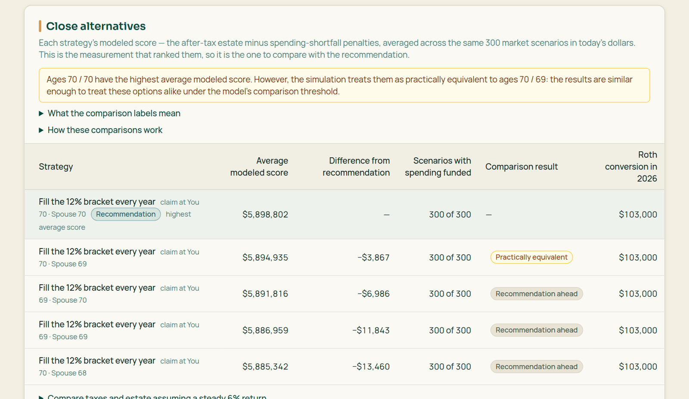
*Close alternatives. The amber note appears when an alternative is “Practically equivalent” or “Too close to distinguish”.*

The strategies nearest the recommendation, ranked the way the optimizer ranked
them: by average modeled score across the same market scenarios. Each row shows
the strategy (and, for a search, its claim ages), its average score, its
difference from the recommendation (negative means lower), its scenarios with
spending funded, and a comparison label. When some strategies convert in the
first year, a column shows that amount. An alternative scored on fewer
scenarios than the recommendation was eliminated in the first screening stage
(every strategy on the first 100 scenarios; the three leaders and *no
conversions* on all 300) — it is shown for context and is never ranked above a
fully scored strategy. See [How a recommendation is chosen](HOW_A_RECOMMENDATION_IS_CHOSEN.md#the-steps-at-fixed-claim-ages).

**What the comparison labels mean** sits beside the table:

| Label | Plain meaning |
|---|---|
| **Recommendation ahead** | These simulations provide evidence favoring the recommendation. |
| **Alternative ahead** | These simulations provide evidence favoring the alternative. |
| **Practically equivalent** | The results are similar enough to treat these options alike under the model's comparison threshold. |
| **Too close to distinguish** | These simulations don't give us enough evidence to say which option is better. |

*Practically equivalent* and *Too close to distinguish* are different
conclusions: the first is evidence of a small difference; the second is not
enough evidence to settle the comparison. When some alternatives carry either
label, an amber note names them, and — if they disagree about this year's
conversion — gives the range of first-year amounts. Treat the amount as a range
and compare its ends on the What-if page before acting.

> **Technical note.** Each alternative is compared with the recommendation
> scenario by scenario. *Recommendation* or *Alternative ahead*: the 95%
> confidence interval of the average difference excludes zero and the median
> difference agrees in sign. *Practically equivalent*: the whole interval lies
> within ±(the larger of $5,000 and 0.25% of your starting assets). *Too close
> to distinguish*: anything else. **Technical details** under the labels, and
> each label's tooltip, show the figures.

**Compare taxes and estate assuming a steady N% return** (collapsed) shows each
alternative's lifetime-tax and estate differences on the steady-return
projection. A strategy can pay less tax or leave more there and still rank
lower, because the ranking reflects how strategies hold up when returns vary.

### Explore other Social Security claim ages

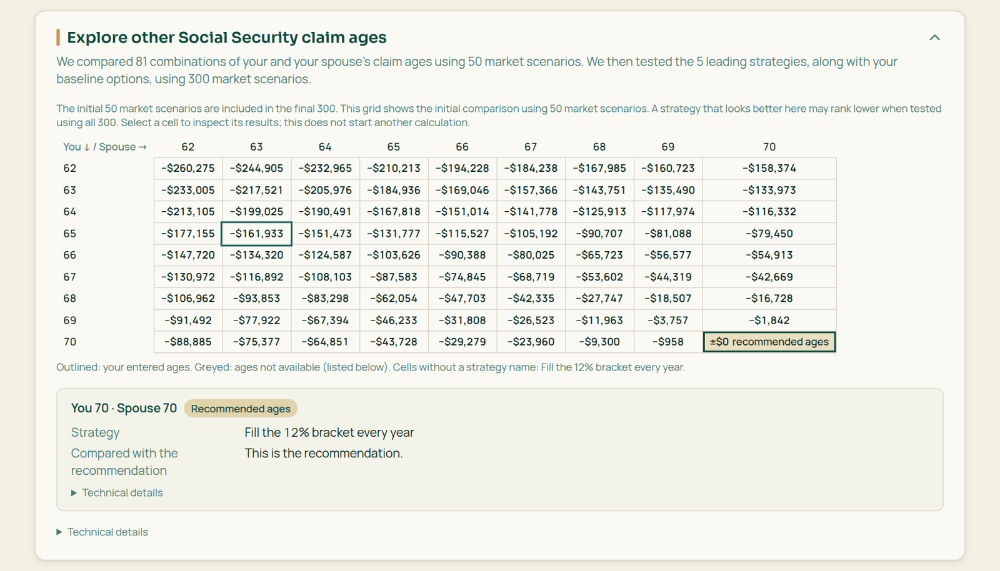
*The claim-age grid. Select a cell to inspect it; this does not start another calculation.*

*(Claim-age searches; collapsed.)* The summary says what was done — for example,
*We compared 48 combinations … using 50 market scenarios. We then tested the 5
leading strategies, along with your baseline options, using 300 market
scenarios.* The first 50 scenarios are part of the 300.

The grid is that **initial comparison**: your ages down the side, your spouse's
across (a single filer sees a list). Each cell shows the pair's best strategy
and its score against the recommendation on the first 50 scenarios. The
recommended pair is tagged; your comparison ages are outlined; ages that could
not be searched are greyed, with the reason below. Selecting a cell shows the
saved measurements for that pair; it does not run another optimization. A pair
that looks better in the grid may rank lower with all 300 scenarios, and only
pairs tested on all 300 can be recommended.

### What if you live longer or shorter?

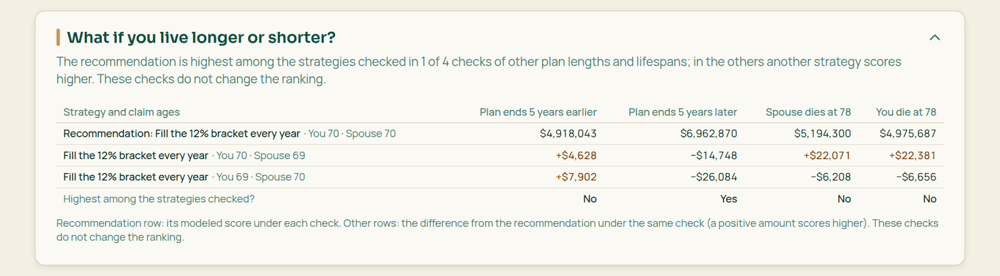
*Lifespan checks re-score the leading strategies. They do not change the ranking.*

*(Claim-age searches; collapsed.)* The leading strategies re-scored with the plan
ending **5 years earlier** or **5 years later** and, for a couple under 78, with
**you** or **your spouse dying at 78**. The recommendation's row shows its score
under each check; other rows show their difference from it. **Highest among the
strategies checked?** answers per check.

These checks compare only the strategies checked, not every possible strategy,
and they are reported, not used to rank. A recommendation that stays highest
across them is less sensitive to how long you live.

### Charts

**Account balances by year**, **Annual taxes by type** and **Roth conversions by
year** all follow the steady-return projection. Dashed markers show years that
shape the plan — a salary ending, a Social Security claim, the first RMD.

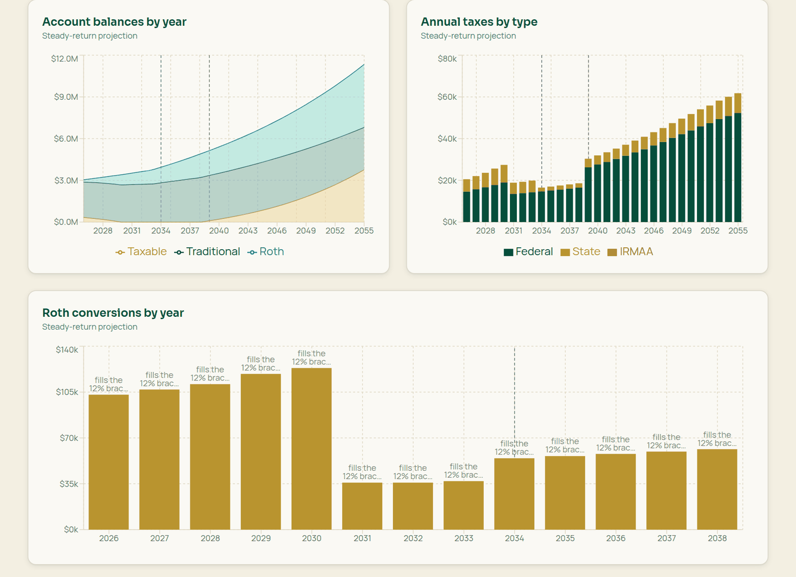
*The three charts follow the steady-return projection.*

### Year-by-Year Plan

One row per year of the steady-return projection: ages, conversion, RMD, which
accounts fund the year, total tax, marginal rate, **Bracket Room**, net spendable
and total balance.

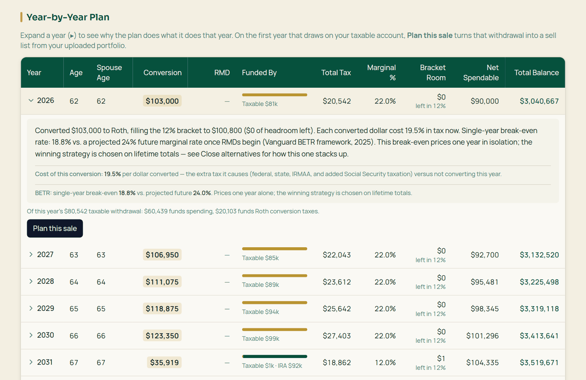
*Expand a year to see why the plan does what it does that year.*

- **Bracket Room** is how much more ordinary income fits in the year's federal
  bracket — *$33,000 left in 12%*. *Marginal %* is the rate on the next dollar,
  so a year filled to the top of 12% shows 22% there and *$0 left in 12%* here.
- A year where spending is planned below target (with *Cut back, then recover*)
  shows the amount below target in amber.
- A year the plan cannot fund shows the gap in red — *$29,000 short*. The table
  continues to the end of the plan anyway, showing what income alone covers.

Expand a year (▸) for its explanation: what the conversion did and why, which
thresholds were near (amber badge) or crossed (red badge), the break-even tax
rate for that year's conversion, or the reason there was no conversion. The
break-even rate is a single-year rule of thumb; the lifetime simulation is what
decides.

On the first year that draws on your taxable account, **Plan this sale** turns
the withdrawal into a sell list (see [Use your portfolio](#6-use-your-portfolio)).

### Inputs

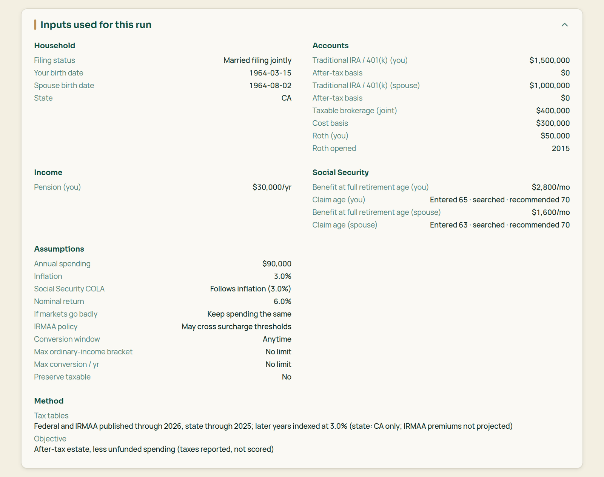
*Every figure the run used, including the claim ages entered, searched and recommended.*

At the bottom: the inputs the run used, including where each claim age came
from — *Entered 67 · searched · recommended 69*, *No comparison age · searched ·
recommended 69*, *Held fixed at 67* or *Already receiving (claimed at 66)*. These are the run's own record; later edits to plans do not
change them.

---

## 5. Explore a different choice

The **What-if** page (top bar) compares your plan with a changed version of it.

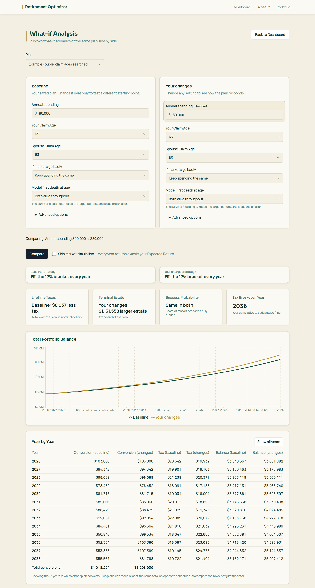
*The What-if page with one change: annual spending lowered from $90,000 to $80,000.*

1. Choose the plan at the top. Both columns fill in with its saved values:
   **Baseline** (your plan) and **Your changes**.
2. Change one or more fields under **Your changes**. Each changed field is
   marked, and a line above **Compare** lists the changes.
3. Click **Compare**. Both sides run on the same market scenarios, so the
   differences come from your changes, not from chance.

What you can change:

- **Annual spending**;
- **Your / Spouse claim age** — held fixed on each side (to search ages, run the
  wizard). The page starts from the ages saved with the plan; only for a
  person with no saved age does it use the latest recommended age. So a plan
  entered with comparison ages 65 / 63 that later recommended 69 / 68 opens
  here at **65 / 63**. Check the Baseline ages shown before comparing, so you
  know whether you are changing the recommendation or your original choices;
- **Model first death at age**, and who dies first (when both have Social
  Security) — the survivor files single, keeps the larger benefit and loses the
  smaller, while RMDs continue;
- **If markets go badly** and **Minimum annual spending**;
- under **Advanced options**: **Strategy** (force a particular strategy instead
  of letting the optimizer choose), **Medicare surcharge thresholds**,
  **Conversion window**, **Max ordinary-income bracket** and **Max Roth
  conversion / year**.

The result shows each side's strategy (marked *forced* if you chose it); cards
for **Lifetime taxes**, **Terminal estate**, **Success probability** and **Tax
breakeven year**, each saying which side comes out ahead; a balance chart; and
a **Year by Year** table that opens on the years either side converts.

**Skip market simulation** (beside Compare) grows every year at exactly your
assumed return. It changes which strategy is chosen and hides the success card
(which would read only 100% or 0%); taxes and estate come from the steady-return
projection either way. Use it to see what strategies do when markets behave as
assumed.

**What-if or a copied plan?** What-if results are not saved. When a change
deserves a permanent record, with exports and a claim-age search, copy the plan
in the wizard instead.

---

## 6. Use your portfolio

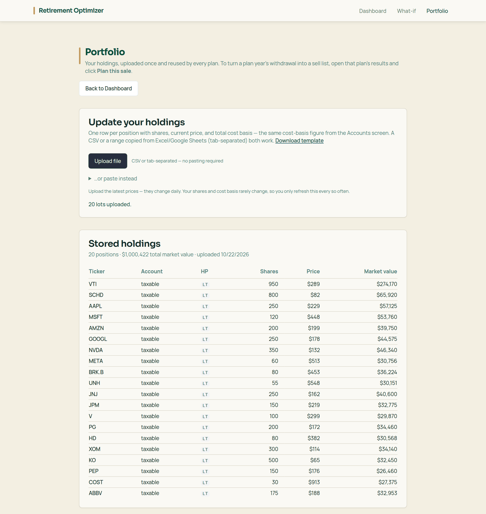
*The Portfolio page after uploading the sample file in the repository.*

**One shared portfolio.** Your holdings are uploaded once from **Portfolio** in
the top bar and shared by every plan. A new upload replaces the previous one.

**What drives what.** The balances and cost basis you enter on the wizard's
**Accounts** step drive the retirement projection. The uploaded holdings are
used for sale planning, and — when you have one taxable account — to fill in
its cost basis when you create a plan. Keep the two consistent.

### The CSV template

Click **Download template** on the Portfolio page. One row per position:

```csv
symbol,shares,price,cost_basis,account_type,long_term
VTI,500,285.10,95225,taxable,
AAPL,200,240.00,19040,taxable,
SNOW,100,180.00,21000,taxable,no
VTSAX,1000,132.50,,traditional,
```

- `cost_basis` is the **total** paid for the whole position, not per share.
  Required for taxable rows; ignored for traditional and Roth.
- `account_type` is `taxable`, `traditional` or `roth`.
- `long_term` is optional; blank means held over a year. Enter `no` for
  positions bought within the past year.
- Dollar signs and commas are fine. You can also paste tab-separated data
  copied from a spreadsheet (**…or paste instead**).

Most brokerages' positions downloads include symbol, shares, price and total
cost basis.

**Price freshness.** Sell lists are priced from your last upload, and show the
upload date. Upload again when prices or holdings have changed.

### Planning a sale

On a plan's results, the first year that draws on the taxable account has
**Plan this sale**. The sell list sells positions at a loss first, then
long-term gains with the smallest gain per dollar raised, then short-term gains
last (with a warning). In a conversion year it also shows how much of the
withdrawal funds spending and how much pays the conversion's tax.

Each line shows the dollars to sell, approximate shares and the gain or loss.
Positions use average cost, not individual tax lots, so the list is
position-level guidance, not broker-ready instructions. The app does not place
trades; review any sale with your advisor or brokerage before acting.

---

## 7. Save and discuss your results

### Exports

Every completed run is saved automatically as CSV, Excel and PDF in the
`reports/` folder of the app, named by date and time. The **CSV**, **Excel** and
**PDF** buttons on the results page generate fresh copies from the stored run
(CSV and Excel download; the PDF opens in a new tab). Each file carries the Run
ID and Plan ID.

| Format | Contents |
|---|---|
| **CSV** | One row per year: balances, income, withdrawals, conversions, each tax, rates and the year's explanation. Claim-age search tables and a sale plan follow when present. |
| **Excel** | Sheets: **Results** (recommendation, summary figures, advisories, market assumptions), **Claim-age search** (searches only), **Inputs**, **Yearly Plan**, **Alternatives**, **Tax Audit**, **Charts**, and **Sale Plans** when a portfolio is uploaded. |
| **PDF** | A formatted report: inputs, the recommendation and summary, market assumptions, charts, close alternatives, claim-age search tables, the year-by-year table and explanations, a sale plan when a portfolio is uploaded, and the AI commentary if you generated one. |

**The Tax Audit sheet** shows, for each year, how the tax was derived: the
ordinary-income stack (salary, pension, rental, interest, dividends,
traditional distributions, net short-term gain, the capital loss deduction,
gross and taxable Social Security), qualified dividends and net long-term
gains, the gains and losses netted into them (already realized, from the plan's
sales, carried in and carried forward), the deduction, taxable income, tax on ordinary
income and on gains, net investment income tax, state tax, the
Medicare-surcharge income from two years earlier and the surcharge. A CPA can check any year against the IRS
*Qualified Dividends and Capital Gain Tax Worksheet* and *Social Security
Benefits Worksheet*.

**Fresh downloads can differ from the saved copies.** A download is generated
when you click. It includes an AI summary generated since the run, prices the
sale plan from your current portfolio upload, and uses the app's current
presentation. The saved copies in `reports/` reflect the moment of the run.

### What to bring to a CFP® professional or CPA

- The PDF report, and the Excel workbook for its Tax Audit and Yearly Plan
  sheets.
- The **Inputs** — so they can confirm balances, basis, income and Social
  Security amounts.
- The **Close alternatives**, especially any *Too close to distinguish* or
  *Practically equivalent* strategies, and the first-year conversion range.
- For a claim-age search, **What if you live longer or shorter?**
- Your questions about anything the app does not model (see
  [Assumptions and limits](#9-assumptions-and-limits)).

### Before acting on a result

- [ ] **Verify the inputs** — balances, cost basis, income, Social Security
      amounts, ages and state.
- [ ] **Review the uncertainty** — the spending-funded range, the comparison
      labels, the first-year conversion range and the lifespan checks.
- [ ] **Confirm current rules** — this year's tax brackets, Medicare thresholds
      and Social Security rules, and anything specific to your state.
- [ ] **Discuss the specific action** — the conversion amount, claim age or
      sale — with the appropriate professional before acting.

---

## 8. Data, privacy and optional AI summaries

### Where your information is kept

| What | Where |
|---|---|
| Saved plans, runs and your uploaded portfolio | One database file on your computer, `data/retire.db` |
| Exported reports | The `reports/` folder |
| A wizard draft in progress, and each plan's claim-age choices | Your browser's storage, for this browser only |

All calculations run on your computer. A draft that has not reached Review is
not a saved plan: it exists only in that browser until you run it.

**Deleting.** **Delete plan** removes the plan, its inputs and all its runs from
the database; this cannot be undone. Files already in `reports/` are not
deleted. Resetting the whole database is described in the
[CLI cheat sheet](CLI_CHEATSHEET.md).

**Backing up.** Stop the app, then copy `data/retire.db` and the `reports/`
folder somewhere safe. To restore, stop the app and copy the file back.

### Optional AI summaries

When an AI model is configured, results pages show **Generate AI summary**. It
writes a plain-English commentary on the run. The commentary is stored with the
run (generating again replaces it), and PDFs downloaded afterwards include it as
*Advisor Commentary*.

The commentary can be wrong. It is generated from the run's figures and does
not change any calculation, ranking or recommendation; the results page and
exports remain the record.

**What the AI service receives** when you click the button:

- filing status, annual spending and the Social Security claim ages you
  entered, and any capital gains already realized this year and loss carried
  into it;
- the recommendation: its strategy, the claim ages it uses (for a search, the
  recommended ages, labelled separately from yours), the first year's
  conversion and the year conversions stop;
- its modeled score and share of scenarios with spending funded, and its
  steady-return totals — lifetime taxes, projected estate, total conversions,
  projected future tax rate — each labelled with its basis;
- for a claim-age search, the comparison with the ages you entered;
- a year-by-year table with your age, conversion, total tax, marginal rate,
  spending and total balance;
- each alternative, with its claim ages, its difference from the
  recommendation and its comparison label; and
- the run's advisories.

It does not receive names, birth dates, your state, individual account
balances, income sources or portfolio holdings.

**Where it goes** depends on how you configure it, in a `.env` file at the
project root (copy `.env.example`):

- **A local model** — any OpenAI-compatible server such as llama.cpp, LM Studio,
  Ollama or vLLM. Set `LLM_BASE_URL` (for example
  `http://localhost:8080/v1`), `LLM_API_KEY` and `LLM_MODEL`. When the server
  runs on your computer, the information never leaves it.
- **Anthropic's API** — set `ANTHROPIC_API_KEY` and install the optional
  package (`pip install -e ".[llm]"`). The information above is sent to
  Anthropic and handled under Anthropic's terms.

If both are set, the local model is used. Without either, the button does not
appear and nothing is sent anywhere. If the model cannot be reached, the page
shows the error (usually a server that is not running or a wrong
`LLM_BASE_URL`).

To change the commentary's style, point `LLM_SYSTEM_PROMPT_FILE` at your own
prompt file (an example is `docs/prompts/advisor.md`). Keep its two rules: use
only the numbers provided, and give no investment advice.

---

## 9. Assumptions and limits

The model is detailed but not complete. These are the boundaries most likely to
matter.

**Taxes**

- Federal tax includes ordinary brackets, the capital-gains rates, the net
  investment income tax, the standard deduction with its age-65 addition and the
  temporary senior deduction.
- **State tax is simplified.** Each state's brackets and standard deduction are
  applied to income as one total. Exemptions for pension or IRA income are not
  modeled, so in states that offer them the app may overstate state tax. In the
  states that tax Social Security, 85% of benefits is included and the states'
  income-based exemptions are not applied, which may also overstate tax.
- **Capital losses.** Gains and losses you enter for this year, and a loss
  carried over, are netted as on Schedule D: up to $3,000 of a net loss is
  deducted from other income and the rest carries forward. Most states use
  the federal result as it is. California and Wisconsin also allow $3,000 a
  year but keep their own carryover, figured on state income and starting from
  the federal carryover you enter. Pennsylvania and New Jersey let a loss
  offset only gains of the same year (no deduction from other income, no
  carryover). Other state-specific treatment of gains (such as Massachusetts'
  short-term rate or Wisconsin's long-term exclusion) is not modeled. A sale the plan
  itself makes from an account worth less than its cost is not credited with a
  loss (the app knows the account's total basis, not which lots are sold), which
  may overstate tax.
- **Future thresholds are projected.** Past the latest published year, federal
  brackets, deductions and Medicare surcharge thresholds grow with your
  inflation assumption; California's brackets are indexed; other states' stay
  at their latest published values. Future Medicare surcharge premiums are not
  increased, which understates them somewhat.

**Social Security**

- Claim ages are whole years from 62 to 70.
- Spousal benefits are applied. Survivor benefits apply in the lifespan checks
  and the What-if death scenario.
- The earnings test is not calculated. The search skips claim ages that
  overlap salary income before full retirement age; this is a modeling
  restriction, not a finding that benefits would be withheld.
- Mortality is not simulated. The *Plan through* ages set the projection's
  end year. They do not trigger a death or a change to survivor benefits or
  single-filer taxes; those changes are explored separately in the lifespan
  checks and the What-if death scenario. Because the
  main advantage of delaying — a larger survivor benefit — appears only when
  someone dies earlier, read the lifespan checks alongside the recommendation.

**Investments and markets**

- Every account earns the same assumed return; there is no separate stock and
  bond allocation.
- The simulation draws each year's return independently from a normal
  distribution with 12% annual volatility, roughly a balanced 60/40 portfolio.
  This understates extreme market falls, and a more stock-heavy portfolio is
  riskier than modeled.
- Inflation, spending and Social Security do not vary between scenarios; only
  returns do.

**Strategies**

- The strategies are a finite set: no conversions; filling the 10, 12, 22, 24
  or 32% bracket each year; or converting 5%, 10% or 20% of the starting
  traditional balance each year — each also stopped after each possible year.
  Your conversion window, Medicare setting and caps apply to all of them, and a
  fixed amount is a maximum that a cap or a year's cash needs can reduce.
- A custom amount and duration is not offered, and the recommendation is the
  best of these strategies, not of every possible schedule.
- Withdrawal order follows the Preserve Taxable Accounts setting; the optimizer
  does not choose it.

**Other**

- Pension survivor elections, charitable giving, qualified charitable
  distributions and tax-loss harvesting are not modeled.
- The Roth five-year rule produces a warning; it does not block withdrawals.
- Sale plans use average cost per position, not tax lots.

---

## 10. Common questions

**Why does the plan recommend no conversions?**
Often because converting does not pay under your inputs — for example, when
conversion income would push dividends and gains out of the 0% capital-gains
rate. Also check the settings that limit conversions: **Max ordinary-income
bracket**, **Max Roth conversion / year**, the **Conversion window** and
**Restrict** for Medicare thresholds ([Step 2](#step-2--planning-assumptions),
[Step 5](#step-5--spending-and-goals)).

**Why does a strategy with lower taxes rank lower?**
The ranking is the modeled score across market scenarios, not lifetime tax on
one steady path. Paying tax early can leave less to weather bad markets. See
[Close alternatives](#close-alternatives).

**Why don't the modeled score and the projected estate match?**
They measure different things. See [Four ideas to know first](#four-ideas-to-know-first).

**What does *Too close to distinguish* mean?**
The simulation does not give enough evidence to say which strategy is better;
it does not mean they are equal. See [Close alternatives](#close-alternatives).

**How do I compare the recommendation with the claim age I had in mind?**
Choose **Find the best eligible age** and enter your age under **Have a claim
age in mind?** ([Step 4](#step-4--income--social-security)), or compare ages on
the [What-if page](#5-explore-a-different-choice).

**Can I convert exactly $X a year for N years?**
Not as a custom entry. The fixed-amount strategies are 5%, 10% and 20% of your
starting traditional balance, each with every stop year. **Max Roth conversion /
year** caps the amount for all strategies.

**How do I change a plan I have already run?**
Copy it in the wizard, or try the change on the What-if page. See
[Changing a plan after it has run](#changing-a-plan-after-it-has-run).

**The plan I want to copy is not in the list.**
The copy list shows your ten most recent plans. The What-if page lists every
plan.

**My dashboard says *Finish setup and run*.**
The plan was saved but never finished running. See [The dashboard](#the-dashboard).

**I stopped the app during a search.**
The search was not saved. Start the app and click **Finish setup and run** on
the plan's card, or **Run again** on the progress page.

**Do I need to upload a portfolio?**
No. It is only used for sale planning and to fill in taxable cost basis. See
[Use your portfolio](#6-use-your-portfolio).

**My old results look different from a new run of the same plan.**
Saved results keep the figures they were made with; the app or tax data may
have been updated since. Re-run the plan.

**How often should I run my plan?**
At least once a year with current balances and tax data, and after any large
change in spending, income, health or tax law.

---

## For technical readers

- [Installation Guide](INSTALL.md) and [CLI cheat sheet](CLI_CHEATSHEET.md) —
  setup, restarting, ports, resetting the database.
- [How a recommendation is chosen](HOW_A_RECOMMENDATION_IS_CHOSEN.md) — the
  strategy menu, stop-year variants, staged screening and ranking, followed
  through four example households with reproducible numbers.
- [Verifying the results](VERIFYING_RESULTS.md) — the built-in checks, reading
  the Tax Audit sheet, and reconciling the app against your own spreadsheet.
- [Optimizer internals](OPTIMIZER_INTERNALS.md) — how candidates are built,
  scored and compared; the claim-age search; the per-year funding solver.
- [Optimizer history](OPTIMIZER_HISTORY.md) — a dated archive of past
  measurements and the evidence behind retiring the greedy search.
- [Annual tax data update checklist](../backend/src/data/tax_rules/ANNUAL_UPDATE_CHECKLIST.md)
  — updating brackets, deductions, Medicare thresholds and state tables each
  year.
- [Changelog](../CHANGELOG.md) — what changed and when.
- [Previous user guide](USER_GUIDE_DEPRECATED.md) — kept for its history and
  worked examples; parts no longer describe the app.
